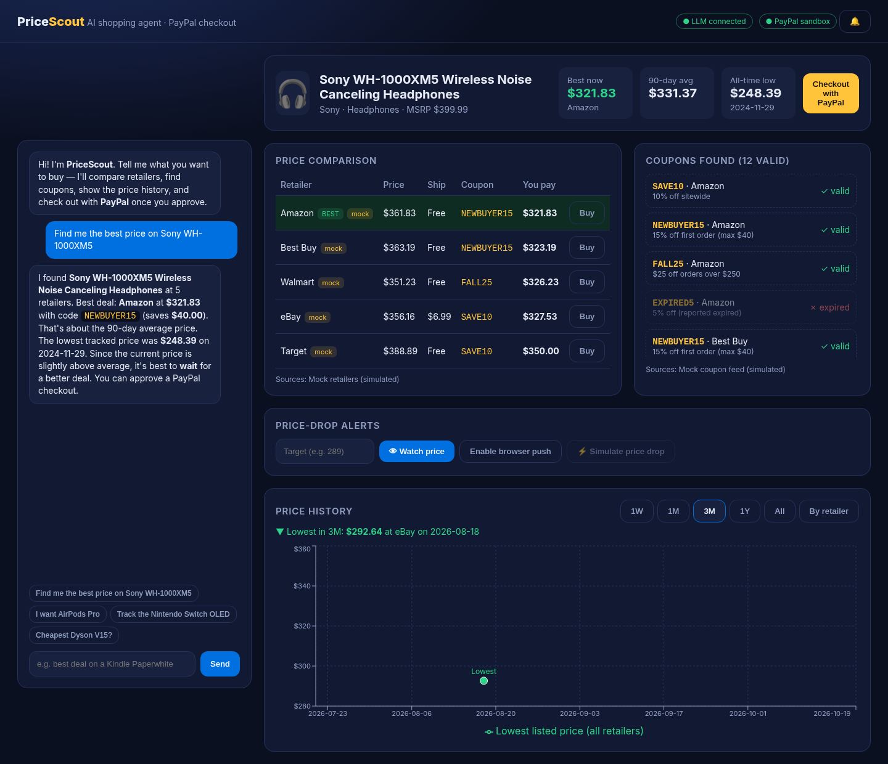

# PriceScout — the AI shopping agent that buys for you (with PayPal)

Submission for the **PayPal AI Hackathon** (Devpost). Tell PriceScout what you want in plain English. It identifies the product, compares prices across retailers, finds and applies coupon codes, charts price history, watches for price drops, and, **only after you approve**, checks out through **PayPal** (sandbox).



## Features
1. **Chat → product identification.** An LLM maps free text ("those Sony noise-cancelling cans") to a catalog product, with a fuzzy-match fallback.
2. **Multi-retailer price tracking.** Pluggable `PriceProvider`s; the best deal is ranked by *effective* price (price + shipping − coupon), with in-stock items first.
3. **Coupon finder.** Pluggable `CouponProvider`s. Each code is checked against the offer (min spend, caps, expired codes) and the best one is applied per retailer.
4. **Price-history chart** (Recharts) with **1W / 1M / 3M / 1Y / All** ranges, a per-retailer breakdown, and the **lowest price + date** highlighted. Snapshots are stored in **SQLite** (sql.js, file at `DATA_DIR/prices.sqlite`), and every lookup and cron run adds a snapshot, so the history grows over time.
5. **AI buy/wait advice** based on the 90-day average and the all-time low.
6. **Price-drop alerts.** Watch a product with an optional target price. A scheduled checker (`/api/cron/check-prices`, run by an external scheduler or manually) re-prices it, records a snapshot, and notifies you when the price falls to or below your target or drops ≥1% from the last check. Each alert includes the new price, the drop amount, the retailer, the coupon, and a one-click **Buy with PayPal** link that opens the approval checkout.
   Channels sit behind a `NotificationChannel` interface:
   - **In-app notification center** (always on, fallback)
   - **Browser Web Push** (service worker + VAPID; no paid service; keys auto-generated if unset)
   - **Email** via Resend *or* SMTP (optional)
   - **SMS** via Twilio (optional; disabled when unconfigured)
   A **⚡ Simulate price drop** button runs the same checker with a ~12% demo markdown.
7. **PayPal checkout with explicit approval.** The server re-prices the deal (the client can't tamper with the amount) and rejects any request without `approved: true`.
   - **Approve & pay with PayPal:** the order is created with the **PayPal Agent Toolkit** `create_order` tool (Orders v2), then you are redirected to PayPal sandbox to approve. `/checkout/return` captures the order with the toolkit's `pay_order` tool. If the toolkit call fails for a non-business reason, it falls back to direct Orders v2 REST.
   - **Instant sandbox test-card pay:** Orders v2 create + capture with PayPal's public sandbox test card, so judges can see a real `COMPLETED` capture without a sandbox buyer login.
   - With no PayPal credentials, checkout is clearly **simulated**.

## What is real vs. mocked
| Part | Status |
|---|---|
| PayPal order create/capture | **Real** PayPal sandbox (Agent Toolkit + Orders v2) when credentials are set; simulated otherwise |
| LLM (identify + advice) | **Real** OpenAI-compatible API when `OPENAI_API_KEY` is set; rule-based otherwise |
| Retailer prices | **Mock** provider (`lib/providers/mockPrices.ts`), labeled "mock" in the UI. Deterministic, realistic curves with Black Friday, July sales and flash sales; 2 years of seeded history |
| Coupons | **Mock** provider (`lib/providers/mockCoupons.ts`), labeled in the UI |
| SQLite history, alerts, cron, push/email/SMS senders | Real |

Free, keyless, legally scrapeable retailer price APIs don't exist. To add live sources, implement `PriceProvider` / `CouponProvider` (for example with an affiliate API like Best Buy Products API, eBay Browse API or Keepa) and register them in `lib/providers/index.ts`.

## AI tools used
- **OpenAI Chat Completions** (`gpt-4o-mini` by default, `OPENAI_MODEL` to change; `OPENAI_BASE_URL` for any compatible endpoint): JSON-mode product identification and grounded deal advice. The model gets only computed facts and has to match the rule-based buy/wait verdict, so it can't invent prices.
- **PayPal Agent Toolkit** (`@paypal/agent-toolkit/openai`): exposes PayPal Orders as LLM-callable tools (`create_order`, `get_order`, `pay_order`). PriceScout invokes them via `handleToolCall`, behind a human approval step.
- Built with the help of an AI coding assistant.

## Quick start
```bash
npm install
cp .env.example .env.local   # fill in what you have; everything is optional
npm run build && npm start   # http://localhost:3000  (or: npm run dev)
```
Checks: `npm run lint`, `npm test` (vitest), `npm run build`. With the app running, `npm run e2e` runs a headless Playwright walkthrough and writes `screenshots/` (first run `npx playwright install chromium`).

### Environment variables
| Var | Purpose |
|---|---|
| `PAYPAL_CLIENT_ID`, `PAYPAL_CLIENT_SECRET`, `PAYPAL_ENV=sandbox` | From developer.paypal.com → Apps & Credentials (Sandbox) |
| `OPENAI_API_KEY`, `OPENAI_MODEL`, `OPENAI_BASE_URL` | LLM (optional) |
| `APP_URL` | Public URL used in alert links (Render sets `RENDER_EXTERNAL_URL` automatically) |
| `DATA_DIR` | SQLite location (default `./data`) |
| `CRON_SECRET` | If set, the cron endpoint needs `Authorization: Bearer <secret>` |
| `VAPID_PUBLIC_KEY`, `VAPID_PRIVATE_KEY`, `VAPID_SUBJECT` | Web Push. `npm run vapid` appends generated keys to `.env.local`. If unset, keys are generated once and stored in SQLite |
| `ALERT_EMAIL_TO`, `ALERT_EMAIL_FROM`, `RESEND_API_KEY` **or** `SMTP_HOST/PORT/SECURE/USER/PASS` | Email alerts |
| `TWILIO_ACCOUNT_SID`, `TWILIO_AUTH_TOKEN`, `TWILIO_FROM`, `ALERT_SMS_TO` | SMS alerts |

### Alert channel setup
- **Web Push:** run `npm run vapid` (or rely on auto-generated keys), open the app, and click **Enable browser push**. Push needs `localhost` or HTTPS. Click a notification's action to land on the approval checkout.
- **Email (Resend):** create an API key at resend.com and set `RESEND_API_KEY` and `ALERT_EMAIL_TO`. Without a verified domain, Resend's `onboarding@resend.dev` sender can only send to your own account email. **Email (SMTP):** set `SMTP_*` instead.
- **SMS (Twilio):** set the `TWILIO_*` vars and `ALERT_SMS_TO`. A trial account can only text verified numbers.
- **Scheduled checks:** `curl -X POST -H "Authorization: Bearer $CRON_SECRET" $APP_URL/api/cron/check-prices`. On Render's free plan, trigger it from an external scheduler (see Deploy to Render).

### Deploy to Render
`render.yaml` defines a single `pricescout` web service on Render's **free plan**. Create a Blueprint from the repo and fill in the `sync: false` secrets.

**Free-plan notes**
- **No persistent disk.** SQLite lives in `./data` on the instance's ephemeral filesystem, so watches, alerts, push subscriptions and orders reset on every redeploy, restart or idle spin-down. Price history is reseeded automatically (deterministic 2-year demo history is generated the first time a product is looked up), so the chart always works. To keep data, switch to the Starter plan and add a disk with `DATA_DIR=/var/data`.
- **No Render cron job** (not free). For scheduled checks, use a free external scheduler (e.g. cron-job.org or a GitHub Actions `schedule`) to `POST $APP_URL/api/cron/check-prices` with `Authorization: Bearer $CRON_SECRET` (copy the generated value from the Render dashboard). For demos, use **⚡ Simulate price drop**.
- Free instances sleep after ~15 minutes idle; the first request takes ~30-60s to wake.

## Architecture
```
app/page.tsx            chat + comparison + coupons + alerts + approval modal (client)
app/PriceChart.tsx      Recharts history with range switcher + lowest-price marker
app/Alerts.tsx          watch panel, push subscription, notification center
public/sw.js            service worker: shows push, click → /?buy=<product>&retailer=<r>
app/api/chat            identify (LLM|rules) → analyze → advise (LLM|rules)
app/api/analyze|history price data for a product / range
app/api/checkout/*      create (Agent Toolkit create_order) · capture (pay_order) · test-card (sandbox)
app/api/watch, alerts/simulate, cron/check-prices, push/*, notifications
lib/providers/*         PriceProvider / CouponProvider plug-ins (mock implementations)
lib/deals.ts            coupon validation + effective-price ranking
lib/db.ts               SQLite (sql.js, file-persisted): snapshots, watches, push subs, notifications, orders
lib/alerts/*            rules (pure), channels (in-app/web-push/email/SMS), checker
lib/paypal.ts           Agent Toolkit + Orders v2 REST fallback + simulated mode
lib/ai.ts               OpenAI calls + deterministic fallback
```

## 3-minute demo script
1. **0:00 Hook.** "Buying online means checking five tabs, hunting coupons, and guessing whether today's price is any good. PriceScout does it all, and then pays for you with PayPal, but only when you say so."
2. **0:20 Chat.** Click *"Find me the best price on Sony WH-1000XM5"*. Point out the LLM badge and that the agent identified the product from free text.
3. **0:40 Compare + coupons.** Show 5 retailers ranked by *effective* price, the auto-applied codes (NEWBUYER15), and an expired code being rejected.
4. **1:05 History.** Switch 1W → 1M → 1Y → All and show the lowest-price marker and date. Toggle *By retailer*. Read the AI's buy/wait advice.
5. **1:30 Alerts.** Set a target, click **Watch price** and **Enable browser push**, then **⚡ Simulate price drop**. Show the push/in-app/email alert with new price, drop, retailer and coupon. Mention that an external scheduler can run the check hourly.
6. **2:05 Buy.** Click **Buy with PayPal** in the alert to open the approval modal with the line items. Click **Approve & pay with PayPal**, which creates the order via the PayPal Agent Toolkit and redirects to PayPal sandbox. Log in as the sandbox buyer and approve; the order is captured on return. (Or use **Instant sandbox test-card pay** to show `COMPLETED` with the capture id.)
7. **2:40 Close.** Architecture slide: pluggable providers and channels, Agent Toolkit tools behind human approval, SQLite history that grows. "Agentic commerce that saves money, not just clicks."

## License
MIT. See [LICENSE](LICENSE).
